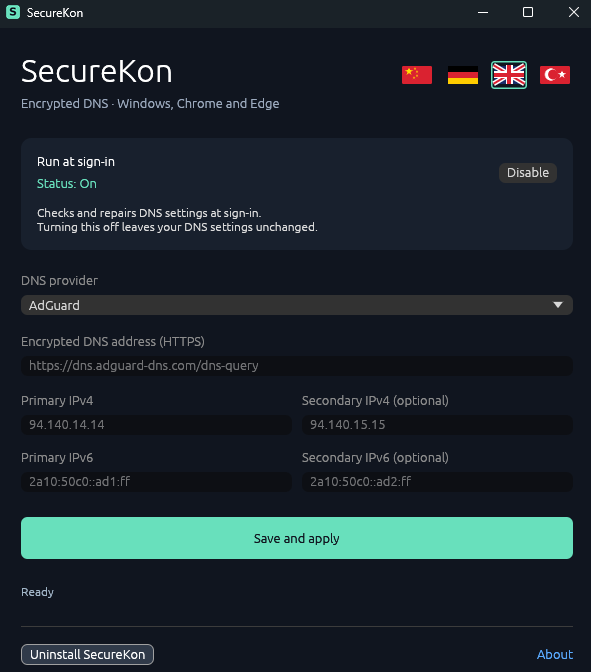

# SecureKon

### Simple Secure DNS Manager

**Windows 11 x64 · Rust · v2.0.0**

**[Download / İndir / Herunterladen / 下载](https://github.com/rhntn/SecureKon/raw/refs/heads/main/downloads/SecureKonSetup.exe)**

[Releases](https://github.com/rhntn/SecureKon/releases) · Created by **[OMTY](https://labs.omty.io)**

[Türkçe](#türkçe) · [English](#english) · [Deutsch](#deutsch) · [简体中文](#简体中文)

---

## Türkçe

**Nedir?**  
Windows, Chrome ve Edge için basit bir şifreli DNS yöneticisi.

**Ne işe yarar?**  
AdGuard, Google, Cloudflare veya özel DNS ayarlarını IPv4 ve IPv6 için uygular. İsteğe bağlı olarak oturum açılışında ayarları kontrol edip düzeltir.

**Nasıl kullanılır?**

1. `SecureKonSetup.exe` dosyasını aç ve **Kur** düğmesine bas.
2. SecureKon'u açıp DNS sağlayıcını seç.
3. **Kaydet ve uygula** düğmesine tıkla.

> **Başlangıçta çalıştır** anında kaydedilir; kapatmak mevcut DNS ayarlarını değiştirmez. PowerShell veya .NET gerekmez.

---

## English

**What is it?**  
A simple encrypted DNS manager for Windows, Chrome and Edge.

**What does it do?**  
Applies AdGuard, Google, Cloudflare or custom DNS settings for IPv4 and IPv6. Optionally checks and repairs settings at sign-in.

**How to use:**

1. Open `SecureKonSetup.exe` and click **Install**.
2. Open SecureKon and choose your DNS provider.
3. Click **Save and apply**.

> **Run at sign-in** is saved immediately; turning it off leaves your DNS settings unchanged. No PowerShell or .NET required.

---

## Deutsch

**Was ist das?**  
Eine einfache Verwaltung für verschlüsseltes DNS unter Windows, Chrome und Edge.

**Was kann es?**  
Wendet AdGuard, Google, Cloudflare oder eigene DNS-Einstellungen für IPv4 und IPv6 an. Prüft und korrigiert die Einstellungen auf Wunsch bei der Anmeldung.

**So geht’s:**

1. `SecureKonSetup.exe` öffnen und **Installieren** anklicken.
2. SecureKon öffnen und einen DNS-Anbieter wählen.
3. **Speichern und anwenden** anklicken.

> **Bei Anmeldung starten** wird sofort gespeichert; das Ausschalten ändert die DNS-Einstellungen nicht. PowerShell und .NET sind nicht erforderlich.

---

## 简体中文

**这是什么？**  
适用于 Windows、Chrome 和 Edge 的简易加密 DNS 管理器。

**有什么用？**  
为 IPv4 和 IPv6 应用 AdGuard、Google、Cloudflare 或自定义 DNS 设置。可在登录时自动检查并修复设置。

**如何使用：**

1. 打开 `SecureKonSetup.exe`，点击 **安装**。
2. 打开 SecureKon，选择 DNS 提供商。
3. 点击 **保存并应用**。

> **登录时启动** 的更改立即保存；关闭此选项不会更改当前 DNS 设置。无需 PowerShell 或 .NET。

---

<strong>Build from source</strong>

Windows: Rust stable and Visual Studio C++ Build Tools with Windows SDK. Run `build.cmd`. The lockfile fixes dependency versions. Linux cross compilation uses the `x86_64-pc-windows-gnu` Rust target and MinGW-w64.

